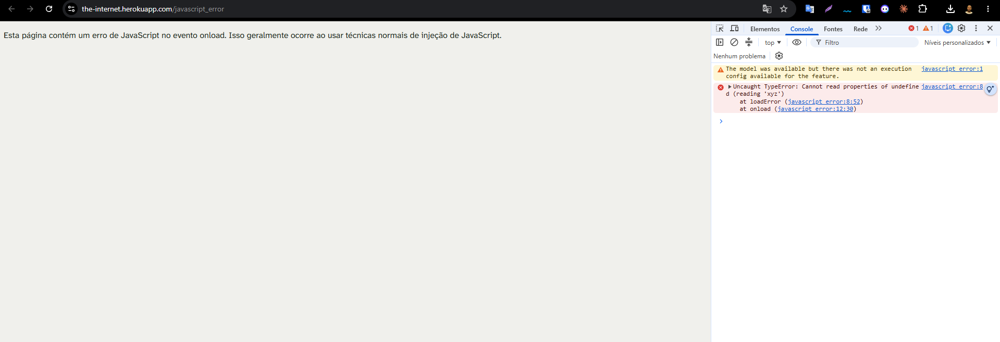
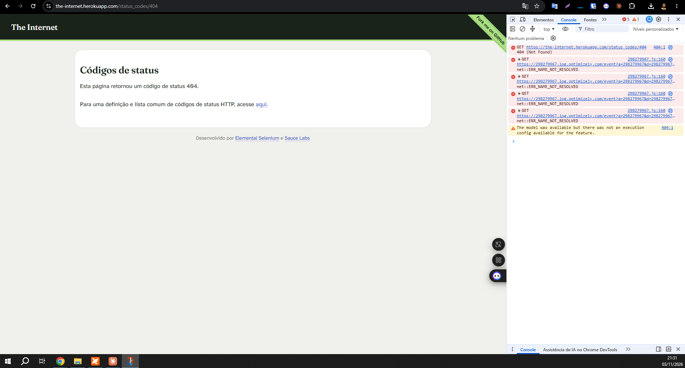
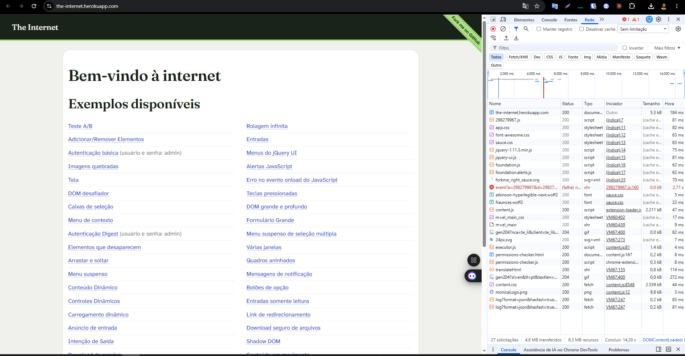
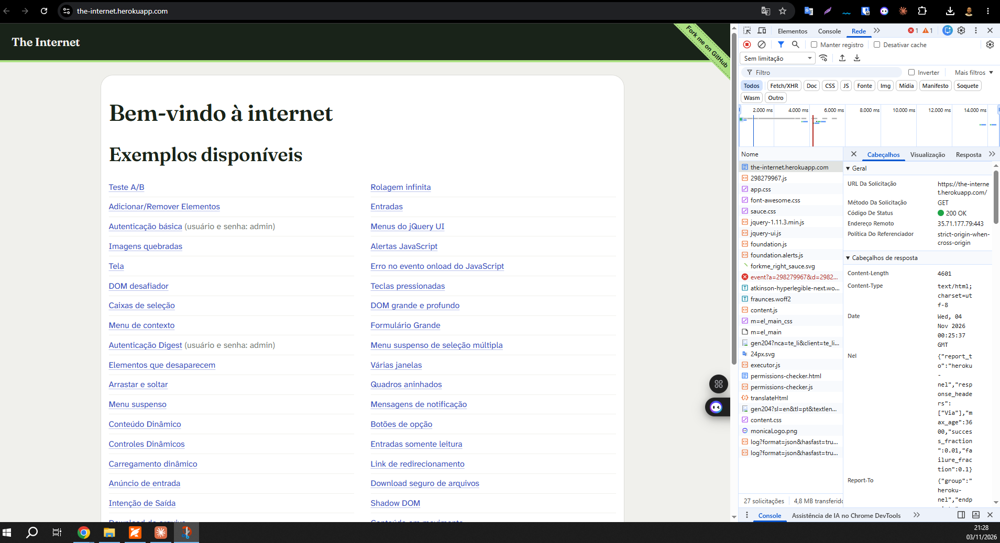
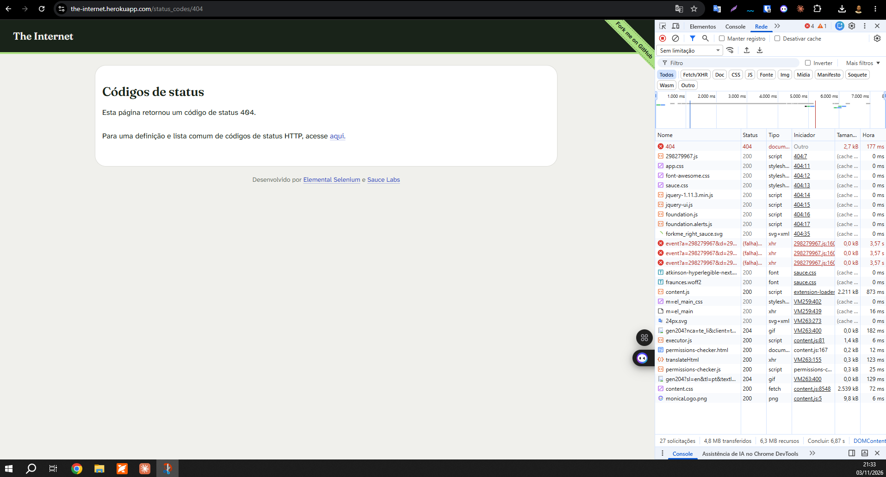
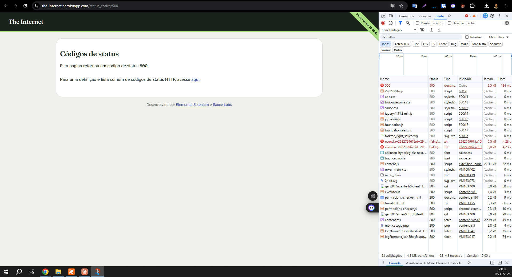

# Relatório de Observabilidade – Investigando um sistema com o DevTools

**Módulo 4 · Observabilidade: qualidade além do clique** – Curso QA do Zero

| Item | Detalhe |
|---|---|
| Autor | Lucas Souza |
| Data da investigação | 03/11/2026 |
| Sistema investigado | [The Internet](https://the-internet.herokuapp.com/) (site de prática) |
| Ferramenta | Chrome DevTools – abas Console e Network |
| Navegador / SO | Google Chrome / Windows 10 |

---

## 1. Objetivo

Investigar o que acontece "por baixo da tela" de uma aplicação web, usando o
Console e a aba Network do navegador para identificar erros, avisos, requisições
e códigos de status HTTP – e entender como essas informações ajudam a investigar
bugs reais.

---

## 2. Tarefa 1 – Investigação do Console

### Páginas visitadas

| Página | Mensagens no Console | Tipo |
|---|---|---|
| `/` (home) | `GET https://298279967.log.optimizely.com/event?... net::ERR_NAME_NOT_RESOLVED` | 🔴 Erro (script de terceiros) |
| `/javascript_error` | `Uncaught TypeError: Cannot read properties of undefined (reading 'xyz')` | 🔴 Erro |
| `/javascript_alerts` | `GET https://298279967.log.optimizely.com/event?... net::ERR_NAME_NOT_RESOLVED` (2x) | 🔴 Erro (script de terceiros) |
| `/status_codes/404` | `GET https://the-internet.herokuapp.com/status_codes/404 404 (Not Found)` + 4 falhas do Optimizely | 🔴 Erro |
| Todas as páginas | `The model was available but there was not an execution config available for the feature.` | ⚠️ Aviso |

### Achados

**Erro 1 – Erro de JavaScript na página `/javascript_error`**



- **O que diz:** o código tentou ler a propriedade `xyz` de algo que estava `undefined`
  (vazio), dentro da função `loadError`, no evento `onload` da página.
- **O que parece indicar:** um defeito no código front-end. Na tela nada aparece
  para o usuário, mas o script quebrou – qualquer funcionalidade que dependesse dele
  deixaria de funcionar silenciosamente.
- **Como ajudaria a investigar um bug real:** a mensagem mostra o **tipo do erro**,
  a **função** e a **linha** (`javascript_error:8`). Num bug real (ex.: "o botão Salvar
  não faz nada"), eu anexaria esse print ao report, e o desenvolvedor iria direto
  à linha certa em vez de tentar adivinhar a causa.

**Erro 2 – Falha de rede em script de terceiros (Optimizely)**

As linhas vermelhas com `optimizely.com` no print abaixo aparecem em todas as páginas do site:



- **O que diz:** `GET https://298279967.log.optimizely.com/event?... net::ERR_NAME_NOT_RESOLVED`.
  O script do Optimizely (ferramenta de métricas e testes A/B) tentou enviar eventos de
  rastreamento – na página `/javascript_alerts`, um de visita à página e outro de "engagement"
  cerca de 8,5 s depois, após eu clicar em um botão – mas o navegador não conseguiu
  resolver o endereço do domínio (falha de DNS).
- **O que parece indicar:** a requisição nunca chegou a um servidor, por isso não há
  status code (na aba Rede aparece como `(falha)`). Provável causa: bloqueio de rastreadores
  no meu ambiente (extensão, antivírus ou DNS da rede) ou domínio desativado.
- **Impacto:** nenhum para o usuário – as páginas funcionam normalmente. O que se perde
  são os dados de métrica.
- **Como ajudaria a investigar um bug real:** separar erro da aplicação de erro de
  terceiros ou do ambiente evita abrir bug falso. Antes de reportar, eu repetiria o teste
  em janela anônima, sem extensões. Se o erro continuasse, reportaria ao time responsável
  pelas métricas, com a URL e o stack trace (`298279967.js:160`).

**Aviso (em amarelo):** em todas as páginas apareceu
`The model was available but there was not an execution config available for the feature.`
Pelo texto, a mensagem parece vir de um recurso interno do próprio Chrome, e não do site,
por isso a classifiquei como ruído do ambiente. Para confirmar, basta abrir a mesma página em
outro navegador e ver se ela some.

> **Observação:** saber separar o ruído do ambiente (extensões, recursos do navegador,
> scripts de terceiros) do erro real do sistema é parte da investigação.

---

## 3. Tarefa 2 – Análise da aba Network

Recarreguei a página inicial com o DevTools aberto e analisei as requisições.



| Requisição | Tipo | Método | Status | Tempo |
|---|---|---|---|---|
| `the-internet.herokuapp.com` (documento HTML) | document | GET | 200 OK | 184 ms |
| `app.css` | stylesheet | GET | 200 (cache) | 82 ms |
| `jquery-1.11.3.min.js` | script | GET | 200 (cache) | 75 ms |
| `event?a=298279967...` (Optimizely) | xhr | GET | **(falha)** | 2,71 s |

**Detalhe de uma requisição com status 200:**



- **URL da solicitação:** `https://the-internet.herokuapp.com/`
- **Método da solicitação:** `GET` – o navegador está *buscando* um recurso, sem enviar dados para alterar nada.
- **Código de status:** `200 OK` – o servidor encontrou e entregou o recurso com sucesso.
- **Endereço remoto:** `35.71.177.79:443` – o IP do servidor que respondeu; a porta 443 indica conexão segura (HTTPS).
- **Content-Type:** `text/html; charset=utf-8` – o servidor avisou que está entregando uma página HTML.
- **Tempo:** 184 ms – resposta rápida (menos de 0,2 segundo).

**Total da página** (rodapé da aba Network): 27 requisições · 4,8 MB transferidos · concluído em 14,20 s.

**Observações:**
- Vários arquivos aparecem com tamanho `(cache)`: o navegador reaproveitou uma cópia
  já baixada em vez de buscar de novo no servidor. Por isso são tão rápidos.
- A única requisição com falha foi o envio de métricas do Optimizely (script de terceiros),
  que levou 2,71 s até desistir – a mesma falha de DNS vista no Console.
- Parte das requisições (`content.js`, `translateHtml`, `monicaLogo.png`, `gen204`) **não é do site**:
  vem das extensões do meu navegador e do tradutor do Chrome. Em uma investigação real,
  testar em janela anônima (sem extensões) evita confundir esse ruído com o sistema.

---

## 4. Tarefa 3 – Provocando erros de status

Acessei `/status_codes` e cliquei em cada código com a aba Network aberta
(com **Preserve log** ativado).

| Código | Significado | Como aparece na Network | O que a tela mostra |
|---|---|---|---|
| **200** | Sucesso – a requisição funcionou | Status `200`, texto normal | "This page returned a 200 status code" |
| **301** | Redirecionamento permanente – o recurso mudou de endereço | Status `301` | "This page returned a 301 status code" |
| **404** | Não encontrado – o recurso pedido não existe | Status `404` **em vermelho** + erro no Console | "This page returned a 404 status code" |
| **500** | Erro interno do servidor – o servidor falhou ao processar | Status `500` **em vermelho** + erro no Console | "This page returned a 500 status code" |

**Status 404:**



Na aba Rede, a requisição `404` aparece **em vermelho** como primeira linha (tipo documento, 2,7 kB, 177 ms).
O servidor respondeu rápido, mas avisando que o recurso pedido **não existe**.

O mesmo 404 também ficou registrado no Console como `GET https://the-internet.herokuapp.com/status_codes/404 404 (Not Found)`,
enquanto a tela mostrava apenas uma página comum com o texto "Esta página retornou um código de status 404":


**Status 500:**



Na aba Rede, a requisição `500` aparece **em vermelho** como primeira linha (tipo documento, 2,5 kB, 184 ms),
enquanto todos os outros arquivos da página (CSS, scripts, fontes) carregaram normalmente com 200.
Ou seja: o servidor respondeu rápido e até devolveu uma página, mas sinalizou que **falhou** ao processar o pedido –
algo que a tela, sozinha, não deixa claro.

### Como isso ajuda a investigar um bug real

- **404:** indica problema de **endereço** – link quebrado, rota digitada errada, recurso
  removido. Direciona a investigação para o front-end (URL errada) ou para o deploy
  (arquivo/rota que não foi publicado).
- **500:** indica que o **servidor quebrou**. O problema não é do usuário nem da tela –
  é do back-end. Com a URL, o horário e o print da requisição, o desenvolvedor consegue
  procurar o erro nos logs do servidor.
- **Família do código** já direciona o bug: `4xx` = problema na requisição (cliente),
  `5xx` = problema no servidor.

---

## 5. Erro na tela × erro só no log

O **erro na tela** é o que o usuário vê: uma mensagem de "algo deu errado", um botão que
não responde, uma página em branco. É fácil de notar, mas quase nunca diz a causa. Ele
mostra o sintoma, não o motivo.

O **erro que só aparece no log** (Console, aba Network, logs do servidor) não aparece para
quem testa só clicando. Vi isso nesta missão: nas páginas de status 404 e 500, a tela parecia
uma página comum, só com um texto diferente, mas a aba Network mostrava o código em vermelho
e o Console registrava o erro. Na página `/javascript_error` a tela carregou normalmente, e
só no Console apareceu o `TypeError`.

Por isso o erro que fica só no log é o **mais perigoso**: passa batido num teste rápido e
pode chegar até o cliente. Ao mesmo tempo, ele é o **mais útil para investigar**, porque traz
o tipo do erro, o arquivo, a linha, a URL e o status code. Com isso eu não reporto só
"não funciona": reporto **o que** falhou, **onde** e **com qual código**.

---

## 6. Conclusão

Aprendi que testar não é só olhar a tela: o DevTools mostra o que o sistema está fazendo por trás. O que mais me surpreendeu foi ver páginas com erro 404 e 500 que, para o usuário, pareciam normais. Também aprendi a separar o erro real do sistema do ruído do ambiente, como extensões do navegador e scripts de terceiros, para não abrir bug falso. Nos meus próximos testes, vou deixar o DevTools aberto, e todo bug que eu reportar vai ter o print do Console e da aba Network.

---

## Estrutura da pasta

```
modulo-4-observabilidade/
├── README.md                       ← este relatório
├── Relatorio_Observabilidade.docx  ← o mesmo relatório em Word
└── prints/                         ← evidências (prints do DevTools)
```
