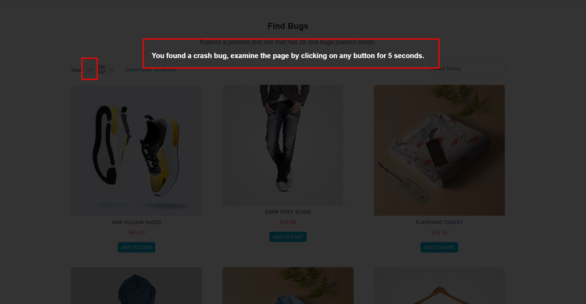

# Módulo 5 – Dia a Dia do QA

Missão prática do **Curso QA do Zero**. Neste módulo fiz um teste exploratório, montei e executei um teste regressivo e acompanhei os bugs que encontrei, do registro até o reteste.

| | |
|---|---|
| Autor | Lucas Souza |
| Quando testei | de 06/11/2026 a 09/11/2026 |
| Site testado | [AcademyBugs](https://academybugs.com/find-bugs/), uma loja virtual feita para treinar teste |
| Versão | 1.0.5 |
| Onde testei | Computador com Windows e Google Chrome |

---

## Resumo

| O que fiz | Casos | Passou | Falhou | Bugs |
|---|---|---|---|---|
| Teste exploratório | 3 | 0 | 3 | BUG-001, BUG-002 e BUG-003 |
| Teste regressivo | 6 | 4 | 2 | BUG-004 (novo) e BUG-001 (que eu já tinha registrado) |

No total achei **4 bugs**. O BUG-004 travou a minha tarefa, então usei ele para mostrar o ciclo de vida completo de um bug.

---

## 1. Teste exploratório (Tarefas 1 e 2)

Arquivo: [Caderno_Exploratorio_Modulo5.xlsx](Caderno_Exploratorio_Modulo5.xlsx)

A minha missão era explorar a loja procurando erro de preço, de imagem e de cálculo no carrinho. Fui olhando produto por produto e mexendo no carrinho, e achei estes três:

| Caso | O que eu olhei | O que aconteceu | Bug |
|---|---|---|---|
| CT-001 | O Grand Total do carrinho com o "DNK Yellow Shoes" em quantidade 2 | O total deu $197,99, mas o certo era $97,99 ($90,00 + $7,99 de frete) | BUG-001 |
| CT-002 | A imagem do "Dark Grey Jeans" na lista de produtos | A imagem não ocupa a caixa toda e sobra um espaço em branco do lado direito | BUG-002 |
| CT-003 | As miniaturas das fotos do "Professional Suit" | A 4ª miniatura aparece quebrada | BUG-003 |

---

## 2. Teste regressivo (Tarefas 3 e 4)

Arquivo: [Caderno_Regressivo_Modulo5.xlsx](Caderno_Regressivo_Modulo5.xlsx)

Montei 6 casos para conferir se as partes principais da loja continuavam funcionando: a lista de produtos, o filtro, a página do produto, o carrinho e o total.

| Caso | O que testei | Prioridade | Resultado | Print | Bug |
|---|---|---|---|---|---|
| CT-001 | A lista mostra os produtos da loja | Alta | ✅ PASSOU | [CT-001.webp](CT-001.webp) | – |
| CT-002 | O filtro View 10 mostra 10 produtos | Média | ❌ FALHOU | [CT-002.png](CT-002.png) | BUG-004 |
| CT-003 | Clicar num produto abre a página dele | Alta | ✅ PASSOU | [CT-003.png](CT-003.png) | – |
| CT-004 | O botão Add to Cart coloca o produto no carrinho | Alta | ✅ PASSOU | [CT-004.png](CT-004.png) | – |
| CT-005 | Mudar a quantidade no carrinho atualiza o total do item | Alta | ✅ PASSOU | [CT-005.png](CT-005.png) | – |
| CT-006 | O Grand Total é igual ao subtotal mais o frete | Alta | ❌ FALHOU | [CT-006.png](CT-006.png) | BUG-001 |

**Resultado final:** 6 casos, 4 passaram e 2 falharam. Nenhum ficou bloqueado ou sem executar.

O CT-006 falhou pelo mesmo motivo do BUG-001, que eu já tinha achado no exploratório. Por isso não abri um bug novo: só liguei o caso ao bug que já existia, para não ficar com dois cards do mesmo problema.

---

## 3. Bug dentro da tarefa: BUG-004 (Tarefa 5)

Arquivo: [BUG-004 - Filtro View 10 (dentro da tarefa).docx](BUG-004%20-%20Filtro%20View%2010%20%28dentro%20da%20tarefa%29.docx)

Quando cliquei no "10" ao lado de "View", a tela escureceu e apareceu uma mensagem de crash. O filtro não funcionou e a lista continuou com os 18 produtos.



Achei esse bug executando o CT-002, então ele faz parte do que eu estava testando. Por isso a tarefa ficou **bloqueada** até o bug ser corrigido e eu conseguir retestar. Coloquei o impacto como **alto**, porque o cliente dá de cara com uma tela de erro e não consegue usar o filtro.

---

## 4. Bug fora da tarefa: BUG-002 (Tarefa 6)

Arquivo: [BUG-002 - Imagem Dark Grey Jeans (fora da tarefa).docx](BUG-002%20-%20Imagem%20Dark%20Grey%20Jeans%20%28fora%20da%20tarefa%29.docx)

Enquanto fazia o CT-001 do regressivo, vi de novo a imagem do "Dark Grey Jeans" com o espaço em branco. Só que o CT-001 confere se a lista mostra os produtos, e isso funcionou, então o caso passou. O problema da imagem é outra coisa. Por isso ele ficou num **card separado**, para ser corrigido depois **sem travar a tarefa**.

---

## 5. Ciclo de vida do bug (Tarefa 7)

Arquivo: [Ciclo de Vida - BUG-004.docx](Ciclo%20de%20Vida%20-%20BUG-004.docx)

```
Aberto  →  Em Correção  →  Em Reteste  →  Resolvido
                ↑               │
                └── se o reteste falhar, o bug volta
```

Nesse documento eu explico:
- quem faz o quê em cada status e em que momento a tarefa é liberada;
- o passo a passo que eu seguiria no reteste quando o dev avisasse que corrigiu;
- o que eu faria se o dev marcasse o bug como **Não é Bug** ou **Won't Fix**.

Como o AcademyBugs é um site de treino, o bug nunca vai ser corrigido de verdade. Então só o status Aberto aconteceu mesmo. O resto eu descrevi do jeito que seria num time real.

---

## 6. Todos os bugs que encontrei

| Bug | O que acontece | Onde achei | Bug report |
|---|---|---|---|
| BUG-001 | O Grand Total do carrinho vem $100,00 a mais | Exploratório (CT-001) e regressivo (CT-006) | [abrir](BUG-001%20-%20Total%20do%20carrinho%20diferente%20da%20soma.docx) |
| BUG-002 | A imagem do "Dark Grey Jeans" não ocupa a caixa toda | Exploratório (CT-002) e regressivo (CT-001), fora da tarefa | [abrir](BUG-002%20-%20Imagem%20Dark%20Grey%20Jeans%20%28fora%20da%20tarefa%29.docx) |
| BUG-003 | A 4ª miniatura do "Professional Suit" aparece quebrada | Exploratório (CT-003) | [abrir](BUG-003%20-%20Miniatura%20do%20Professional%20Suit%20quebrada.docx) |
| BUG-004 | O filtro View 10 mostra uma mensagem de crash | Regressivo (CT-002), dentro da tarefa | [abrir](BUG-004%20-%20Filtro%20View%2010%20%28dentro%20da%20tarefa%29.docx) |

---

## 7. O que aprendi

Essa missão me mostrou como é o dia a dia de um QA num time: explorar o sistema, rodar o regressivo, registrar os bugs com print e acompanhar cada um até ser resolvido. Percebi que o bug report precisa ter os passos bem claros, porque é seguindo eles que o reteste é feito depois. Também aprendi que decidir um "Won't Fix" não é só com o QA: quem decide é o time junto com o PO, e o meu papel é deixar o risco registrado.

---

## O que tem nesta pasta

```
modulo-5-dia-a-dia/
├── README.md                              ← este resumo
├── Caderno_Exploratorio_Modulo5.xlsx      ← Tarefas 1 e 2
├── Caderno_Regressivo_Modulo5.xlsx        ← Tarefas 3 e 4
├── BUG-001 a BUG-003 (.docx)              ← bugs do exploratório
├── BUG-004 - Filtro View 10 (...).docx    ← Tarefa 5
├── Ciclo de Vida - BUG-004.docx           ← Tarefa 7
└── CT-001.webp até CT-006.png             ← prints do regressivo
```
